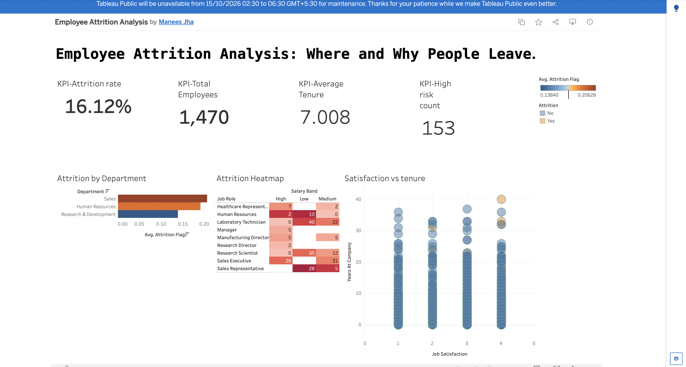

# Employee Attrition Analysis (SQL + Tableau)

Interactive dashboard analysing why employees leave, built on IBM's HR Analytics dataset (1,470 employees).

**Live dashboard:** https://public.tableau.com/app/profile/manees.jha/viz/EmployeeAttritionAnalysis_17915489440100/Dashboard1

## Tools
MySQL (segmentation, window functions) · Tableau Public (dashboard, filter actions)

## Dataset
[IBM HR Analytics Employee Attrition & Performance](https://www.kaggle.com/datasets/pavansubhasht/ibm-hr-analytics-attrition-dataset)

## Key Findings
- Overall attrition is **16.12%**.
- **Sales** has the highest attrition of the three departments (about 20%), and **R&D** the lowest (about 14%).
- **Sales Representatives in the Low salary band leave at 41.18%**, more than 2.5x the company average.
- **153 employees** are flagged high-risk (overtime and job satisfaction of 2 or below).

## Recommendations
1. Target retention efforts at low-paid Sales Representatives first, since they are the highest-risk segment.
2. Review overtime load for the 153 high-risk employees before they resign.
3. Investigate Sales compensation and workload, as it is the highest-attrition department.

## Repository
- `/sql`: analysis queries
- `/screenshots`: dashboard image
